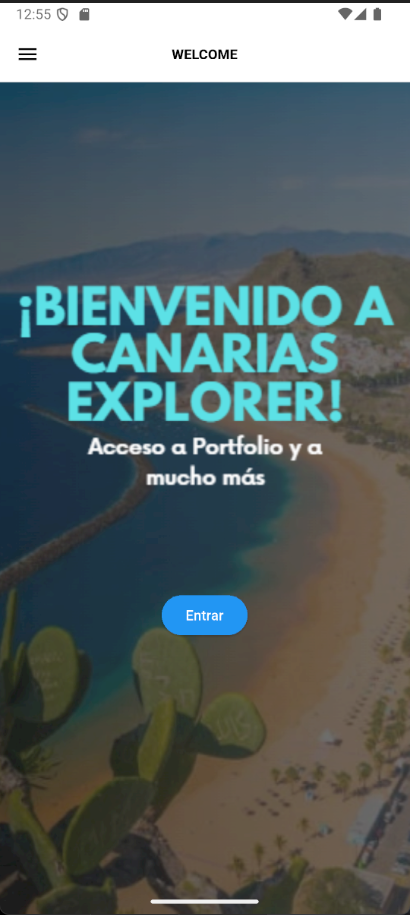
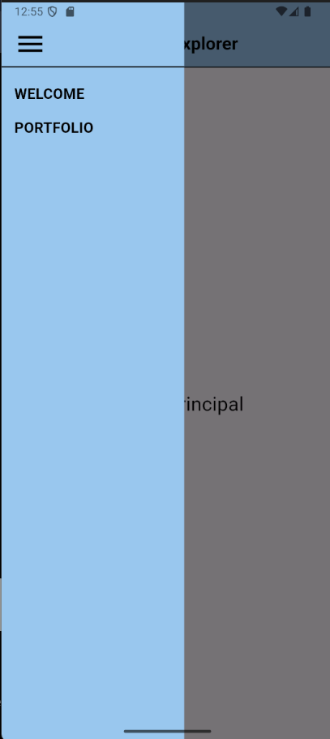
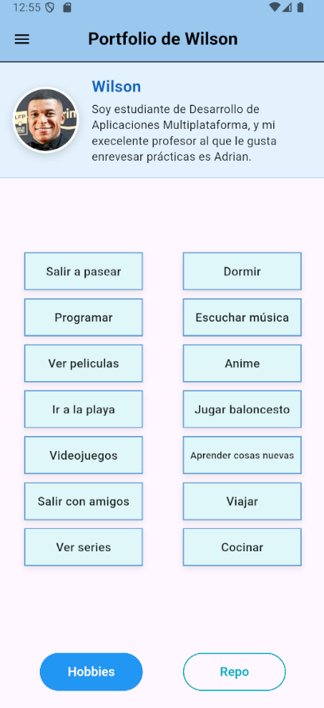
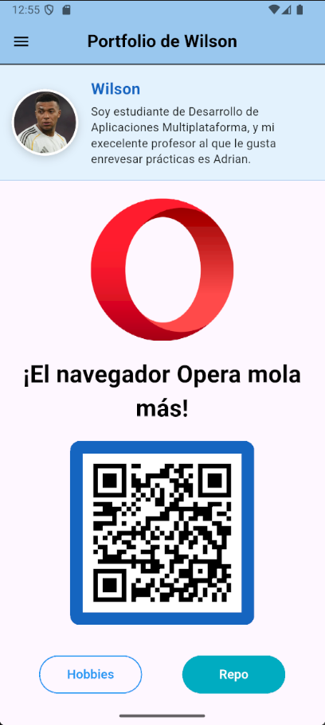

# tareap2test

# 📄 **README.md — PGL-P2-MyPortfolio**

## 📌 **Descripción del proyecto**

Este proyecto es una aplicación móvil desarrollada con **Flutter**, siguiendo las instrucciones de la tarea de clase.
La app, llamada **Canarias Explorer**, incluye navegación mediante un **Drawer** (menú lateral) usando la librería **go_router**, y está formada por varias pantallas:

- **Bienvenida:** pantalla de inicio con imagen de fondo y botón "Entrar"
- **Pantalla principal:** pantalla a la que se accede con el botón "Entrar"
- **Portfolio:** portfolio personal desarrollado en la tarea anterior, adaptado a los colores del nuevo diseño

El objetivo es aplicar navegación con rutas, reutilizar widgets y adaptar un proyecto anterior a uno nuevo.

---

## ✅ **Pasos de la tarea realizados**

1. Creación del proyecto Flutter **PGL-P2-MyPortfolio** y enlace a un repositorio de GitHub.
2. Implementación de la navegación mediante un **Drawer** con **go_router**.
3. Desarrollo de la pantalla de **bienvenida** diseñada en la tarea anterior y añadida al Drawer.
4. Incorporación de la pantalla de **portfolio** personalizado, con los colores adaptados al nuevo diseño.

---

## 🛠️ **Tecnologías utilizadas**

- **Flutter 3.x**
- **Dart**
- **go_router** (navegación)
- **qr_flutter** (código QR del portfolio)
- **Emulador Android**
- Widgets como:
  - `Scaffold`
  - `AppBar`
  - `Drawer`
  - `InkWell`
  - `Stack`
  - `Expanded`
  - Widgets personalizados

---

## 🧭 **Navegación con go_router**

Las rutas se definen en un único archivo, `app_router.dart`:

| Ruta | Pantalla |
|------|----------|
| `/bienvenida` | `WelcomeScreen` (ruta inicial) |
| `/home` | `HomeScreen` |
| `/portfolio` | `PortfolioScreen` |

- En `main.dart` se usa `MaterialApp.router` con `routerConfig: router`.
- El Drawer es un widget propio (`AppDrawer`) que se reutiliza en todas las pantallas.
- Cada opción del Drawer navega con `context.go('/ruta')`.
- La opción de la pantalla actual aparece subrayada.

---

## 📁 **Estructura del proyecto**

```
lib/
├── main.dart
├── app_router.dart
├── screens/
│   ├── welcome_screen.dart
│   ├── home_screen.dart
│   └── portfolio_screen.dart
└── widgets/
    ├── app_drawer.dart
    ├── info_personal_widget.dart
    ├── body_hobbies_widget.dart
    ├── body_repositorio_widget.dart
    ├── footer_botones_widget.dart
    └── hobby_card.dart
```

---

## 🎨 **Personalización realizada**

- Adaptación de los colores del portfolio anterior (naranja) al azul del nuevo diseño
- Drawer con el estilo del concepto: fondo azul claro y opciones en mayúsculas
- Cabecera (`AppBar`) con el mismo color que el Drawer
- Cambio de nombre del widget `CosaRandom` por `HobbyCard`, más descriptivo
- Separación del código en widgets para mejorar la legibilidad

---

## 📸 **Capturas de pantalla**

### 🖼️ **Captura 1 — Pantalla de bienvenida**



---

### 🖼️ **Captura 2 — Drawer**



---

### 🖼️ **Captura 3 — Portfolio (Hobbies)**



---

### 🖼️ **Captura 4 — Portfolio (Repositorio con QR)**



---

## ▶️ **Cómo ejecutar el proyecto**

```
flutter pub get
flutter run
```

---

## 👨‍💻 **Autor**

**Wilson José Riascos Vera**