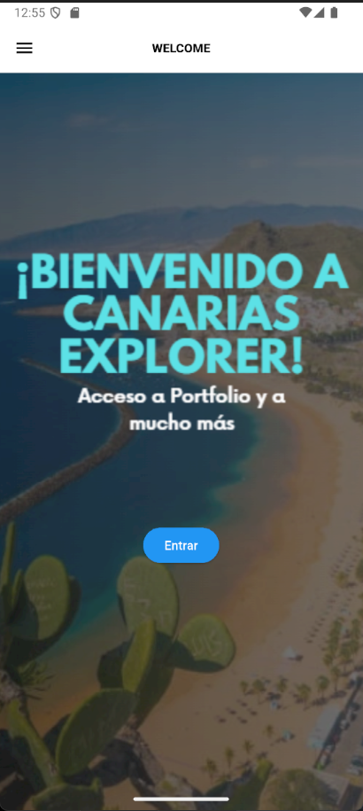
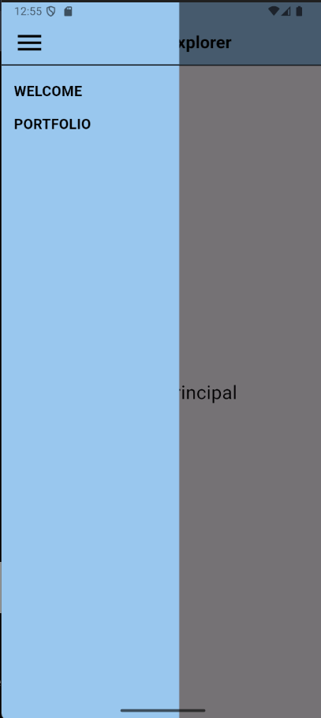
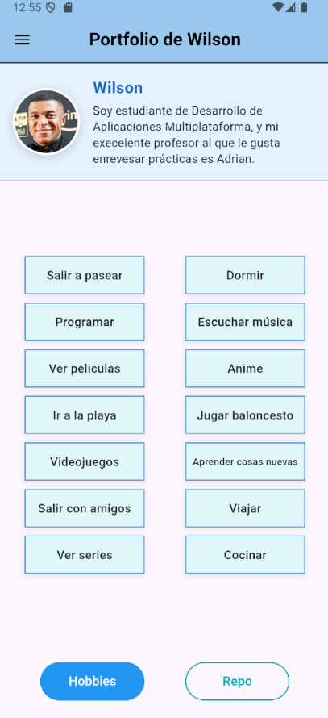
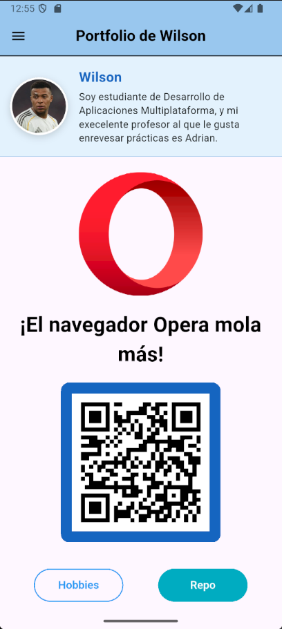
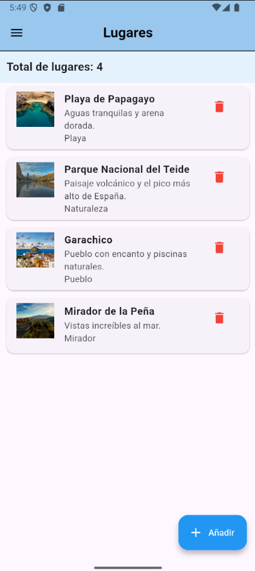
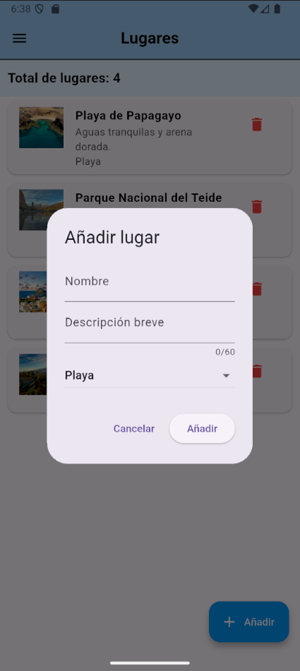
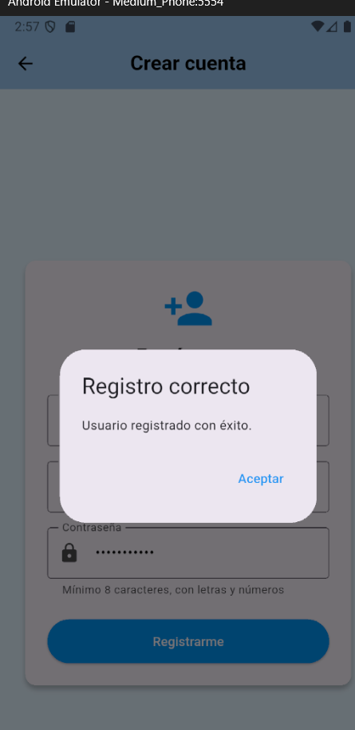
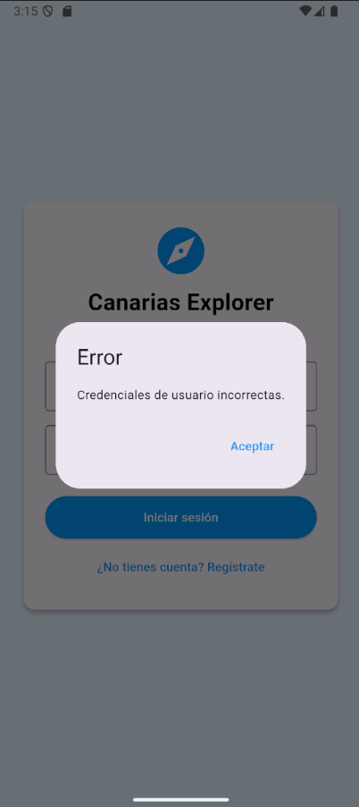
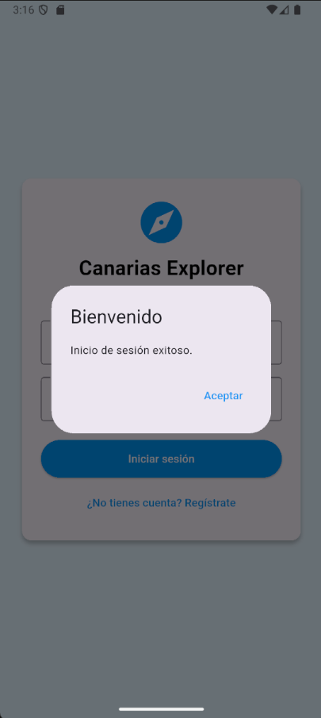
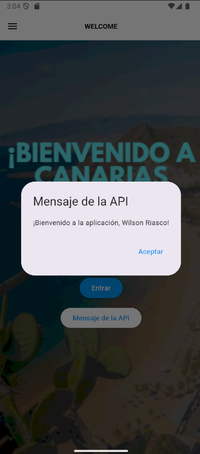

# 📄 **README.md — PGL-P2-MyPortfolio**

## 📌 **Descripción del proyecto**

Este proyecto es una aplicación móvil desarrollada con **Flutter**, siguiendo las instrucciones de las tareas de clase.
La app, llamada **Canarias Explorer**, incluye registro e inicio de sesión de usuarios con **tokens JWT**, navegación mediante un **Drawer** (menú lateral) usando la librería **go_router**, y está formada por varias pantallas:

- **Login:** pantalla de inicio de sesión (es la primera que se muestra al abrir la app)
- **Registro:** pantalla para crear una cuenta nueva
- **Bienvenida:** pantalla con imagen de fondo, botón "Entrar" y botón para mostrar el mensaje de la API
- **Pantalla principal:** pantalla a la que se accede con el botón "Entrar"
- **Portfolio:** portfolio personal desarrollado en una tarea anterior, adaptado a los colores del nuevo diseño
- **Lugares:** pantalla con un **CRUD** de lugares de las Islas Canarias (añadir, listar y borrar)

---

## ✅ **Tareas realizadas**

### Tarea 1 — Navegación

1. Creación del proyecto Flutter **PGL-P2-MyPortfolio** y enlace a un repositorio de GitHub.
2. Implementación de la navegación mediante un **Drawer** con **go_router**.
3. Desarrollo de la pantalla de **bienvenida** y adición al Drawer.
4. Incorporación de la pantalla de **portfolio** personalizado, con los colores adaptados al nuevo diseño.

### Tarea 2 — CRUD

1. Pantalla **Lugares** para el CRUD, añadida al Drawer.
2. Elementos mostrados en una **lista dinámica** (`ListView.builder`).
3. Botón **"Añadir"** que abre un **modal** (`AlertDialog`).
4. Cada elemento tiene **nombre**, **descripción breve** y **selector de categoría**.
5. La **categoría** determina la **imagen** que se muestra al lado del elemento.
6. Cada elemento tiene un **botón para borrarlo**.
7. **Marcador** con el **número total** de elementos de la lista.

### Tarea 3 — Registro e inicio de sesión (JWT)

1. **Pantalla de registro:** nombre completo, email y contraseña, con validación de los campos. Muestra una **alerta** con la respuesta de la API y, si el registro es correcto, redirige al login.
2. **Pantalla de login:** email y contraseña, botón para iniciar sesión y botón para ir al registro. Muestra una **alerta** con la respuesta de la API.
3. **Token guardado de forma segura** en el dispositivo con `flutter_secure_storage`.
4. **Al iniciar la app** solo se muestra el login (sin Drawer). Si hay un token guardado, se comprueba en la API y, si sigue siendo válido, se redirige automáticamente a la bienvenida.
5. **Cierre de sesión** con un botón en el Drawer: borra el token y redirige al login.
6. **Botón en la bienvenida** que muestra en una alerta el mensaje que devuelve el endpoint de bienvenida de la API.
7. Peticiones HTTP **encapsuladas en servicios** y **validación** de los datos del usuario.

---

## 🛠️ **Tecnologías utilizadas**

- **Flutter 3.x**
- **Dart**
- **go_router** (navegación)
- **http** (peticiones a la API)
- **flutter_secure_storage** (almacenamiento seguro del token)
- **qr_flutter** (código QR del portfolio)
- **Emulador Android**
- Widgets como:
  - `Scaffold`, `AppBar`, `Drawer`
  - `Form` y `TextFormField` (con validación)
  - `AlertDialog`
  - `ListView.builder`, `Card` y `ListTile`
  - `FloatingActionButton`
  - `Wrap`
  - Widgets personalizados

---

## 🔐 **Registro e inicio de sesión**

La app se conecta a la API del profesor: `https://my-users-api.onrender.com`

| Método | Endpoint | Autenticación | Uso en la app |
|--------|----------|---------------|---------------|
| `POST` | `/users/register` | Pública | Registro de usuario (`fullName`, `email`, `pwd`) |
| `POST` | `/users/login` | Pública | Inicio de sesión (`email`, `pwd`). Devuelve el token JWT |
| `GET` | `/users/check-token` | Bearer Token | Comprobar si el token guardado sigue siendo válido |
| `GET` | `/users/welcome` | Bearer Token | Mensaje de bienvenida personalizado |

### Servicios

Las peticiones están separadas de las pantallas en la carpeta `services`:

- **`auth_service.dart`:** todas las peticiones HTTP a la API (registro, login, comprobar token y mensaje de bienvenida).
- **`secure_storage_service.dart`:** guarda, lee y borra el token en el almacenamiento seguro del dispositivo.

### Flujo de la app

1. La app arranca siempre en **`/login`**, sin Drawer ni otras pantallas.
2. Al abrir el login se comprueba si hay un token guardado y si la API lo da por válido. Si lo es, se va directamente a **`/bienvenida`**.
3. Si no, el usuario puede **registrarse** o **iniciar sesión**. Con un login correcto el token se guarda y se accede a la bienvenida.
4. En la bienvenida, el botón **"Mensaje de la API"** pide el mensaje con el token y lo muestra en una alerta.
5. El botón **"CERRAR SESIÓN"** del Drawer borra el token y vuelve al login.

### Validaciones

- **Nombre completo:** obligatorio, mínimo 3 caracteres.
- **Email:** obligatorio y con formato válido.
- **Contraseña (registro):** mínimo 8 caracteres, con letras y números.
- **Contraseña (login):** obligatoria.

> Nota: la API se suspende tras 15 minutos sin tráfico y puede tardar cerca de un minuto en responder a la primera petición. Mientras tanto la app muestra un indicador de carga.

---

## 🧭 **Navegación con go_router**

Las rutas se definen en un único archivo, `app_router.dart`:

| Ruta | Pantalla |
|------|----------|
| `/login` | `LoginScreen` (ruta inicial) |
| `/registro` | `RegisterScreen` |
| `/bienvenida` | `WelcomeScreen` |
| `/home` | `HomeScreen` |
| `/portfolio` | `PortfolioScreen` |
| `/lugares` | `LugaresScreen` |

- En `main.dart` se usa `MaterialApp.router` con `routerConfig: router`.
- El Drawer es un widget propio (`AppDrawer`) que se reutiliza en las pantallas de la app (no aparece en login ni registro).
- Cada opción del Drawer navega con `context.go('/ruta')`, y la opción actual aparece subrayada.

---

## 📍 **Pantalla de Lugares (CRUD)**

| Operación | Cómo se hace |
|-----------|--------------|
| **Listar** | `ListView.builder` recorre la lista `lugares` y dibuja una tarjeta por cada elemento |
| **Crear** | El botón "Añadir" abre un `AlertDialog` con nombre, descripción y selector de categoría |
| **Borrar** | El icono de la papelera elimina el elemento con `removeAt` y redibuja con `setState` |
| **Contar** | El marcador superior muestra `lugares.length` y se actualiza automáticamente |

**Categorías disponibles:** Playa, Naturaleza, Pueblo y Mirador, cada una con su imagen en `assets/images/`.

---

## 📁 **Estructura del proyecto**

```
lib/
├── main.dart
├── app_router.dart
├── screens/
│   ├── login_screen.dart
│   ├── register_screen.dart
│   ├── welcome_screen.dart
│   ├── home_screen.dart
│   ├── portfolio_screen.dart
│   └── lugares_screen.dart
├── services/
│   ├── auth_service.dart
│   └── secure_storage_service.dart
├── utils/
│   └── validaciones.dart
└── widgets/
    ├── alerta.dart
    ├── app_drawer.dart
    ├── info_personal_widget.dart
    ├── body_hobbies_widget.dart
    ├── body_repositorio_widget.dart
    ├── footer_botones_widget.dart
    └── hobby_card.dart
```

---

## 🎨 **Personalización realizada**

- Adaptación de los colores del portfolio anterior (naranja) al azul del nuevo diseño
- Drawer con el estilo del concepto: fondo azul claro y opciones en mayúsculas
- Cabecera (`AppBar`) con el mismo color que el Drawer
- Pantallas de login y registro con tarjeta centrada, iconos y los colores de la app
- Cambio de nombre del widget `CosaRandom` por `HobbyCard`, más descriptivo
- Hobbies del portfolio mostrados a partir de una lista con `Wrap`
- Separación del código en pantallas, servicios, utilidades y widgets

---

## 📸 **Capturas de pantalla**

### 🖼️ **Captura 1 — Pantalla de bienvenida**



---

### 🖼️ **Captura 2 — Drawer**



---

### 🖼️ **Captura 3 — Portfolio (Hobbies)**



---

### 🖼️ **Captura 4 — Portfolio (Repositorio con QR)**



---

### 🖼️ **Captura 5 — Lugares (lista y marcador de total)**



---

### 🖼️ **Captura 6 — Lugares (modal para añadir)**



---

### 🖼️ **Captura 7 — Registro exitoso**



---

### 🖼️ **Captura 8 — Login fallido**



---

### 🖼️ **Captura 9 — Login exitoso**



---

### 🖼️ **Captura 10 — Mensaje de bienvenida (botón de la pantalla Bienvenida)**



---

## ▶️ **Cómo ejecutar el proyecto**

```
flutter pub get
flutter run
```

---

## 👨‍💻 **Autor**

**Wilson José Riascos Vera**