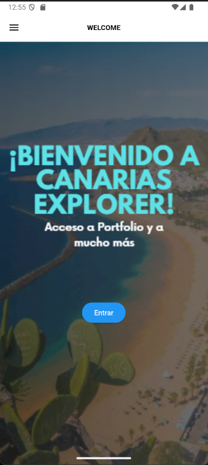
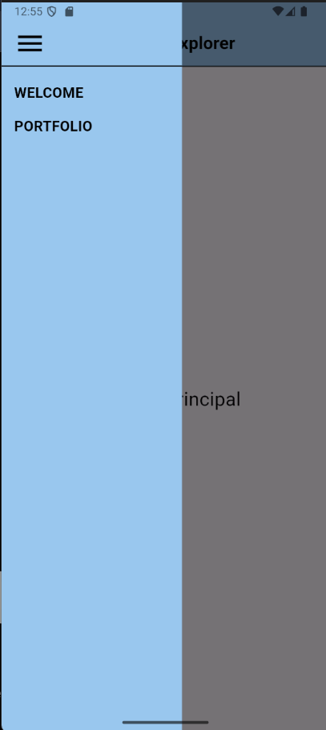
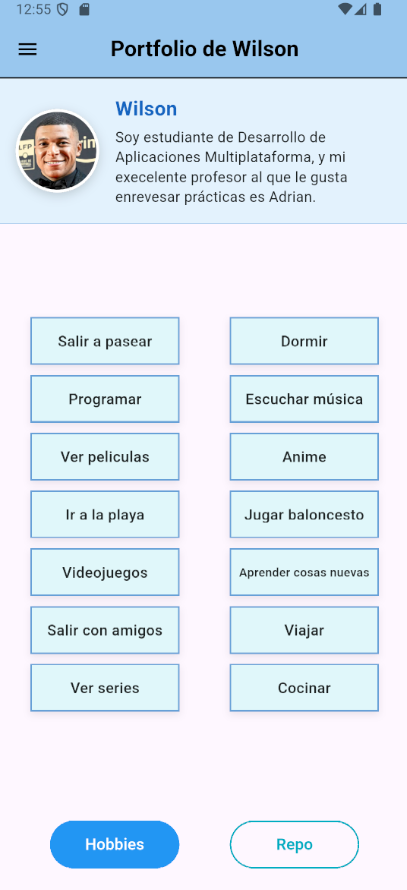
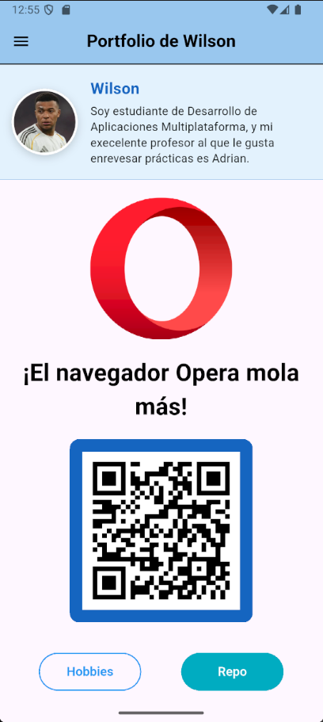
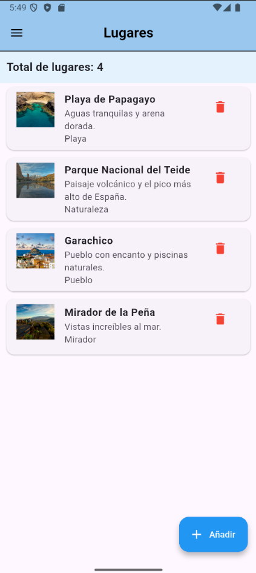
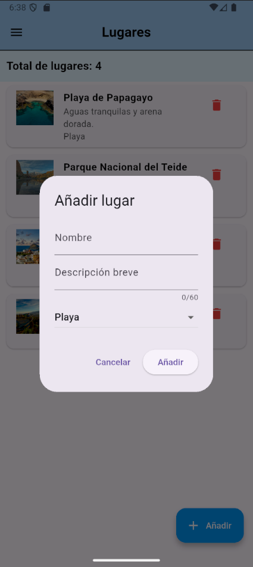

# 📄 **README.md — PGL-P2-MyPortfolio**

## 📌 **Descripción del proyecto**

Este proyecto es una aplicación móvil desarrollada con **Flutter**, siguiendo las instrucciones de las tareas de clase.
La app, llamada **Canarias Explorer**, incluye navegación mediante un **Drawer** (menú lateral) usando la librería **go_router**, y está formada por varias pantallas:

- **Bienvenida:** pantalla de inicio con imagen de fondo y botón "Entrar"
- **Pantalla principal:** pantalla a la que se accede con el botón "Entrar"
- **Portfolio:** portfolio personal desarrollado en una tarea anterior, adaptado a los colores del nuevo diseño
- **Lugares:** pantalla con un **CRUD** de lugares de las Islas Canarias (añadir, listar y borrar)

El objetivo es aplicar navegación con rutas, reutilizar widgets, adaptar un proyecto anterior a uno nuevo y trabajar con listas dinámicas y diálogos.

---

## ✅ **Pasos de las tareas realizados**

### Tarea 1 — Navegación

1. Creación del proyecto Flutter **PGL-P2-MyPortfolio** y enlace a un repositorio de GitHub.
2. Implementación de la navegación mediante un **Drawer** con **go_router**.
3. Desarrollo de la pantalla de **bienvenida** diseñada en la tarea anterior y añadida al Drawer.
4. Incorporación de la pantalla de **portfolio** personalizado, con los colores adaptados al nuevo diseño.

### Tarea 2 — CRUD

1. Creación de la pantalla **Lugares** para el CRUD y adición al Drawer.
2. Los elementos se muestran en una **lista dinámica** (`ListView.builder`).
3. Botón **"Añadir"** que abre un **modal** (`AlertDialog`) para crear un elemento.
4. Cada elemento tiene **nombre**, **descripción breve** (máximo 60 caracteres) y **selector de categoría**.
5. La **categoría** determina la **imagen** que se muestra al lado del elemento.
6. Cada elemento tiene un **botón para borrarlo**.
7. **Marcador** en la parte superior con el **número total** de elementos de la lista.

---

## 🛠️ **Tecnologías utilizadas**

- **Flutter 3.x**
- **Dart**
- **go_router** (navegación)
- **qr_flutter** (código QR del portfolio)
- **Emulador Android**
- Widgets como:
  - `Scaffold`
  - `AppBar`
  - `Drawer`
  - `ListView.builder`
  - `Card` y `ListTile`
  - `AlertDialog`
  - `TextField` y `DropdownButton`
  - `FloatingActionButton`
  - `Wrap`
  - Widgets personalizados

---

## 🧭 **Navegación con go_router**

Las rutas se definen en un único archivo, `app_router.dart`:

| Ruta | Pantalla |
|------|----------|
| `/bienvenida` | `WelcomeScreen` (ruta inicial) |
| `/home` | `HomeScreen` |
| `/portfolio` | `PortfolioScreen` |
| `/lugares` | `LugaresScreen` |

- En `main.dart` se usa `MaterialApp.router` con `routerConfig: router`.
- El Drawer es un widget propio (`AppDrawer`) que se reutiliza en todas las pantallas.
- Cada opción del Drawer navega con `context.go('/ruta')`.
- La opción de la pantalla actual aparece subrayada.

---

## 📍 **Pantalla de Lugares (CRUD)**

Cada lugar es un objeto de la clase `Lugar` (`lib/models/lugar.dart`), con tres campos: `nombre`, `descripcion` y `categoria`.

| Operación | Cómo se hace |
|-----------|--------------|
| **Listar** | `ListView.builder` recorre la lista `lugares` y dibuja una tarjeta por cada elemento |
| **Crear** | El botón "Añadir" abre un `AlertDialog` con nombre, descripción y selector de categoría |
| **Borrar** | El icono de la papelera elimina el elemento con `removeAt` y redibuja con `setState` |
| **Contar** | El marcador superior muestra `lugares.length` y se actualiza automáticamente |

**Categorías disponibles:** Playa, Naturaleza, Pueblo y Mirador. Cada una tiene su imagen en `assets/images/`:

- `playa.png`
- `naturaleza.png`
- `pueblo.png`
- `mirador.png`

Si falta alguna imagen, la app muestra un icono en su lugar en vez de fallar.

---

## 📁 **Estructura del proyecto**

```
lib/
├── main.dart
├── app_router.dart
├── models/
│   └── lugar.dart
├── screens/
│   ├── welcome_screen.dart
│   ├── home_screen.dart
│   ├── portfolio_screen.dart
│   └── lugares_screen.dart
└── widgets/
    ├── app_drawer.dart
    ├── info_personal_widget.dart
    ├── body_hobbies_widget.dart
    ├── body_repositorio_widget.dart
    ├── footer_botones_widget.dart
    └── hobby_card.dart
```

---

## 🎨 **Personalización realizada**

- Adaptación de los colores del portfolio anterior (naranja) al azul del nuevo diseño
- Drawer con el estilo del concepto: fondo azul claro y opciones en mayúsculas
- Cabecera (`AppBar`) con el mismo color que el Drawer en todas las pantallas
- Cambio de nombre del widget `CosaRandom` por `HobbyCard`, más descriptivo
- Hobbies del portfolio mostrados a partir de una lista (`List<String>`) con `Wrap`, en lugar de repetir cada widget a mano
- Pantalla de Lugares basada en el diseño de Canarias Explorer, pero simplificada
- Separación del código en widgets, modelos y pantallas para mejorar la legibilidad

---

## 📸 **Capturas de pantalla**

### 🖼️ **Captura 1 — Pantalla de bienvenida**




---

### 🖼️ **Captura 2 — Drawer**




---

### 🖼️ **Captura 3 — Portfolio (Hobbies)**




---

### 🖼️ **Captura 4 — Portfolio (Repositorio con QR)**



---

### 🖼️ **Captura 5 — Lugares (lista y marcador de total)**



---

### 🖼️ **Captura 6 — Lugares (modal para añadir)**



---

## ▶️ **Cómo ejecutar el proyecto**

```
flutter pub get
flutter run
```

---

## 👨‍💻 **Autor**

**Wilson José Riascos Vera**